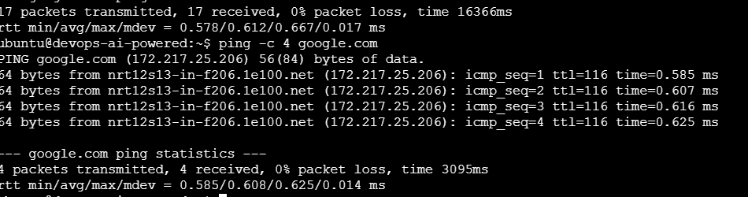
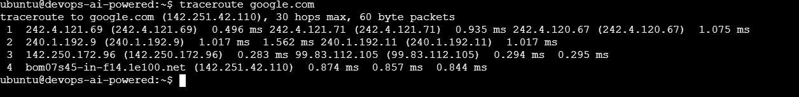

OSI Layer
1. 7 layers from Physical to Application
OSI is a theoretical reference model with 7 layers, while TCP/IP is a practical protocol suite with 4 layers that the internet actually runs on. OSI describes how networking should work in the abstract; TCP/IP is the working implementation.

| OSI Layer        | TCP/IP Layer         | What It Does               | Example Protocols      |
| ---------------- | -------------------- | -------------------------- | ---------------------- |
| 7 – Application  | Application          | Network services to apps   | HTTP, HTTPS, DNS, SMTP |
| 6 – Presentation | Application (merged) | Encryption, encoding       | TLS/SSL                |
| 5 – Session      | Application (merged) | Session setup/teardown     | Sockets, RPC           |
| 4 – Transport    | Transport            | End-to-end delivery, ports | TCP, UDP               |
| 3 – Network      | Internet             | Addressing & routing       | IP, ICMP               |
| 2 – Data Link    | Link                 | Local delivery, frames     | Ethernet, Wi-Fi, ARP   |
| 1 – Physical     | Link (merged)        | Bits over wires/radio      | Cables, signals |

Where Common Protocols sit
1. HTTP/HTTPS : In Application layer
2. DNS : Application Layer
3. TCP/UDP : Transport Layer
4. IP : Internet layer

When we run curl https://example.com, the request travels down like this:
1. Application(L7): curl builds an HTTP request. Before that, DNS resolves example.com to an IP address.
2. Transport(L4) : The request id handed to TCP, which segments the data and targets the port 443(HTTPS) on the destination.
3. Internet(L3) : TCP segments are wrapped in IP packets addressed to the destination IP.
4. Link(L2/L1) : Packets become frames and then physical signals on your local network. 

Commands
1. hostname -I - Gives the private IPv4 address.
2. ping -c 4 google.com - Shows the reachability and measures how long the data takes to travel and back

3. traceroute google.com - the complete path your packets take across the network — every router ("hop") between your computer and the destination — along with how long each leg of the journey takes.

4. sudo ss -tulpn - shows every TCP and UDP port your machine is listening on, along with the exact process (name and PID) that owns each one.

| Flag | Meaning                                                                                                                             |
| ---- | ----------------------------------------------------------------------------------------------------------------------------------- |
| -t   | Show TCP sockets                                                                                                                    |
| -u   | Show UDP sockets                                                                                                                    |
| -l   | Show only listening sockets (ports waiting for connections)                                                                         |
| -p   | Show the process name and PID using each socket                                                                                     |
| -n   | Numeric output — show raw port numbers and IPs instead of resolving names (e.g., :443 instead of :https), and skip slow DNS lookups |

5. dig google.com - command-line tool that sends DNS queries to name servers and shows you the complete, raw response
6. curl - command line tool for transferring data to and from servers using URLs.
7. ss -tan | head - It lists all the TCP sockets on your machine
8. netstat -an | head - It's the legacy equivalent of the ss -tan | head you just ran — it lists all network connections and listening ports with numeric addresses, and head trims it to the first 10 lines.
